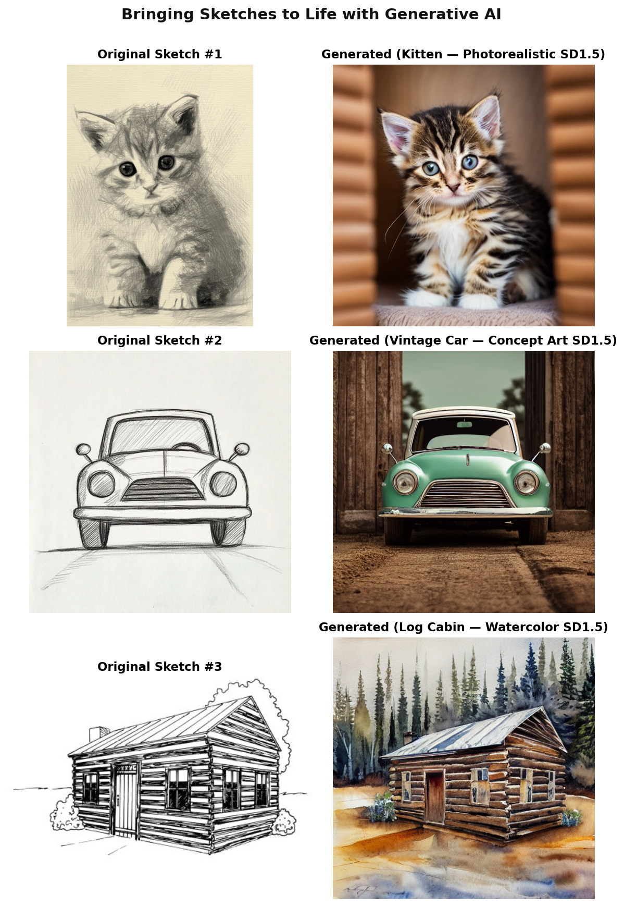
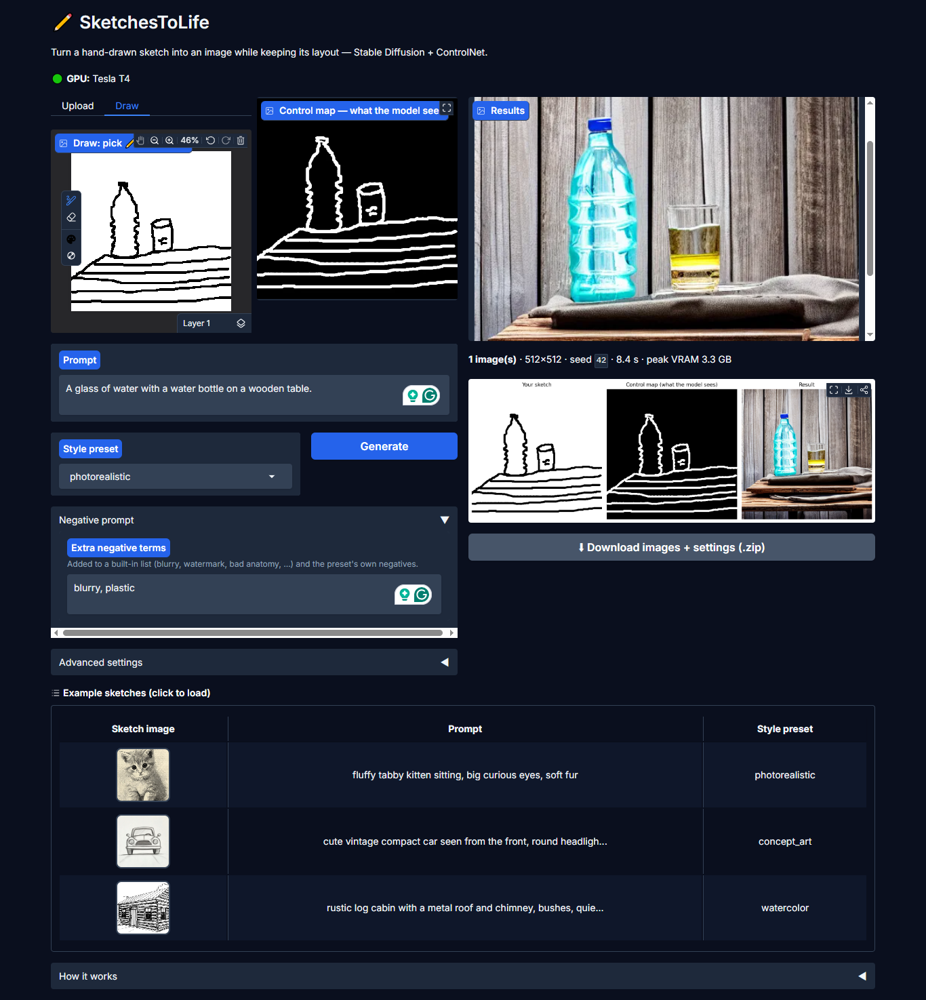
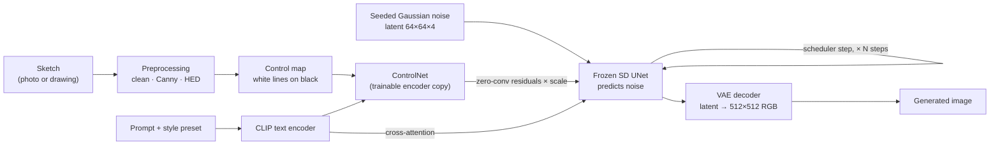
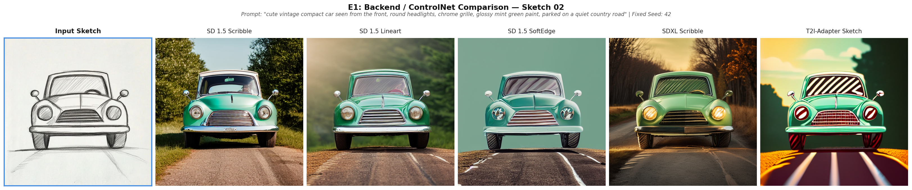
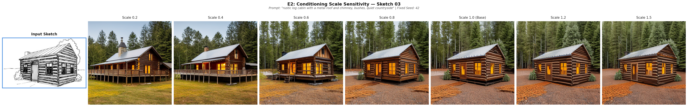
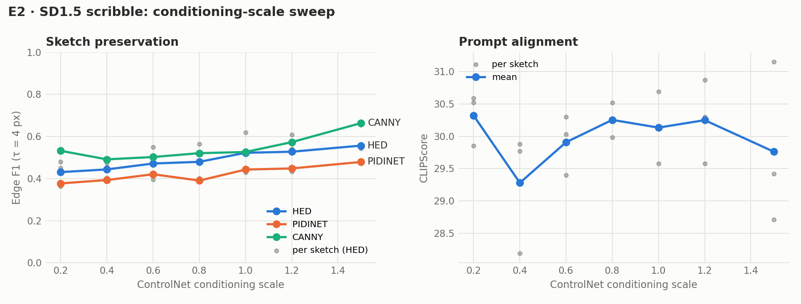

# SketchesToLife

**Turn a rough sketch into a finished image that keeps your layout: Stable Diffusion
guided by ControlNet, run through a reproducible Python pipeline.**

[](https://colab.research.google.com/github/Wajid011/SketchesToLife/blob/main/notebooks/sketch2image_colab.ipynb)




**Wajid Ali** · MSc, Machine Learning and Computer Vision II, UPEC ·
Technical report: [report/REPORT.pdf](report/REPORT.pdf)

Pretrained diffusion models only, no fine-tuning. All results in this repository were
generated on a single NVIDIA Tesla T4 (Kaggle).

---

## Contents

[Features](#features) · [Web app](#web-app) · [Repository structure](#repository-structure) ·
[Installation](#installation) · [Hardware](#hardware-requirements) ·
[Quick start](#quick-start) · [Configuration](#configuration-reference) ·
[How it works](#how-it-works) · [Results](#results) ·
[Reproducibility](#reproducibility) · [References & credits](#references--credits)

## Features

- **Three backends:** SD 1.5 + ControlNet v1.1 (scribble / lineart / softedge),
  SDXL + ControlNet scribble at 1024 px, and SD 1.5 + T2I-Adapter sketch.
- **Robust sketch preprocessing:** illumination normalisation for phone photos,
  adaptive thresholding, automatic inversion, speck removal, stroke thickening/thinning,
  aspect-preserving padding to multiples of 64. Optional Canny / HED / PiDiNet / lineart
  control maps.
- **Style presets:** photorealistic, architectural render, concept art, product studio,
  watercolor, cyberpunk, anime and oil painting, each with matching negative prompts.
- **Config-driven experiments (E1–E8)** with publication grids, resumable runs,
  and a JSON sidecar per image recording every parameter, model ID, seed, runtime and peak VRAM.
- **Objective metrics:** edge F1 / IoU with distance tolerance, Chamfer distance and
  edge SSIM for sketch fidelity; CLIPScore for prompt alignment.
- **Gradio web app:** upload or draw, live control-map preview, zip download with settings.
- **Reproducible:** fixed seeds, `scripts/reproduce.sh` with a SHA-256 manifest, and a
  notebook that runs end to end on Colab or Kaggle.

## Web app



Upload a sketch or draw one on the canvas. The control map (exactly what ControlNet
receives) appears beside it. Pick a prompt and a style preset, optionally tune the advanced
settings, and download the results together with a `settings.json`. The screenshot shows a
bottle and glass drawn directly in the app and generated on a Kaggle T4 in 8.4 s
(peak VRAM 3.3 GB); the files of that run are in [results/app_demo/](results/app_demo/).

## Repository structure

```
SketchesToLife/
├── app/app.py                    Gradio web app
├── configs/
│   ├── default.yaml              all generation settings (see Configuration reference)
│   └── experiments/e1…e8_*.yaml  experiment sweeps (fixed params + swept param)
├── notebooks/
│   └── sketch2image_colab.ipynb  end-to-end run on Colab or Kaggle (install → figures → app)
├── scripts/
│   ├── run_experiments.py        run sweeps E1–E8, build grids + hero figure
│   ├── analyze.py                metrics.csv, plots, results/ANALYSIS.md
│   ├── reproduce.sh              regenerate every figure from configs + checksum manifest
│   ├── build_report.py           report/REPORT.md → report/REPORT.pdf
│   └── check_env.py              environment / GPU diagnostic
├── sketches/                     input sketches (sketch_01–03.jpg)
├── src/sketch2image/
│   ├── preprocessing.py          sketch cleaning + control-map extraction
│   ├── pipelines.py              SketchToImageGenerator (SD 1.5 / SDXL / T2I-Adapter)
│   ├── generate.py               style presets, generation runner, CLI
│   ├── metrics.py                edge F1/IoU, Chamfer, edge SSIM, CLIPScore
│   ├── visualize.py              comparison grids, hero figure
│   └── utils.py                  config loading, seeding, environment info
├── tests/unit/                   CPU-only tests (GPU code is mocked)
├── results/                      figures, metrics.csv, ANALYSIS.md, app demo + screenshots
├── report/                       technical report (Markdown + PDF) and its figures
└── outputs/                      raw generations (git-ignored)
```

## Installation

**pip** (GPU machine / Colab):

```bash
git clone https://github.com/Wajid011/SketchesToLife.git && cd SketchesToLife
# Colab/Kaggle: skip this line, PyTorch is preinstalled. Elsewhere, install a CUDA build
# of PyTorch >= 2.2 matching your Python, e.g.:
pip install torch torchvision --index-url https://download.pytorch.org/whl/cu121
pip install -r requirements.txt
pip install -e . --no-deps
python scripts/check_env.py
```

`requirements.txt` installs exact, tested pins on Python ≤ 3.12 (Colab, local) and only
lower bounds on Python 3.13 (Kaggle), where the platform's preinstalled packages are kept.

**conda** (creates the `sketch2image` env with PyTorch + CUDA 12.1 and installs the package):

```bash
conda env create -f environment.yml
conda activate sketch2image
```

**Local CPU development** (tests, linting, UI work in mock mode; downloads no models).
Use a virtual environment with **Python 3.10–3.12**:

```powershell
py -3.12 -m venv .venv              # Windows (macOS/Linux: python3.12 -m venv .venv)
.venv\Scripts\activate              # macOS/Linux: source .venv/bin/activate
python -m pip install --upgrade pip
pip install -r requirements-dev.txt
pip install -e . --no-deps
pytest                              # 71 passed, 1 skipped (the HED test needs controlnet-aux)
```

## Hardware requirements

| Task | Hardware |
|---|---|
| SD 1.5 + ControlNet / T2I-Adapter (512 px) | NVIDIA GPU, fp16. A free Colab or Kaggle **T4 (16 GB)** is enough: measured 6–9 s per image and under 3.5 GB peak VRAM |
| SDXL + ControlNet (1024 px) | Same T4 with `enable_model_cpu_offload()` (set automatically): measured 60 s per image, 7.9 GB peak VRAM |
| Development, tests, UI | Any CPU machine. Generation falls back to a clearly labelled **mock** backend |
| Disk | Model weights are downloaded to the Hugging Face cache (several GB per backend) |

## Quick start

**Single image (CLI):**

```bash
python -m sketch2image.generate --sketch sketches/sketch_01.jpg \
  --prompt "fluffy tabby kitten sitting, big curious eyes, soft fur" \
  --preset photorealistic --scale 1.0 --seed 42
```

Writes the image, a `…_condition.png`, a side-by-side `…_grid.png` and a `…_meta.json`
to `outputs/` (or to `$OUTPUT_DIR`). Add `--mock` to try it on a CPU.

**Batch experiments:**

```bash
python scripts/run_experiments.py -e E1 E2 E6   # or: -e all
python scripts/analyze.py                       # metrics.csv, plots, ANALYSIS.md
```

| ID | Experiment | Swept |
|---|---|---|
| E1 | Backend / ControlNet comparison | SD1.5 scribble · lineart · softedge · SDXL scribble · T2I-Adapter |
| E2 | Conditioning scale | 0.2, 0.4, 0.6, 0.8, 1.0, 1.2, 1.5 |
| E3 | Guidance (CFG) scale | 3, 5, 7.5, 10, 13 |
| E4 | Control guidance end | 0.4, 0.6, 0.8, 1.0 |
| E5 | Preprocessing | raw · cleaned · Canny · lineart |
| E6 | Style presets | photorealistic · architectural render · concept art · watercolor · cyberpunk |
| E7 | Steps × scheduler | {20, 30, 50} × {DPM++ 2M Karras, Euler a, UniPC} |
| E8 | Seed variability | 42, 123, 777, 999 |

E1, E2 and E6 (51 images) are the experiments reported in `results/` and in the report;
E3–E5, E7 and E8 are configured and can be run the same way.

**Web app:**

```bash
python app/app.py            # http://127.0.0.1:7860
python app/app.py --share    # public gradio.live link (use this on Colab / Kaggle)
```

The app runs on Gradio 4.31 (pinned, Python ≤ 3.12) and on Gradio 5/6 (Kaggle, Python 3.13).
On Gradio 5+ pick the ✏️ brush before drawing on the canvas.

**Colab / Kaggle:** open the notebook (badge at the top, or *File ▸ Import Notebook* on
Kaggle), select a T4 GPU, and run all cells. Set `RUN_FULL_REPRODUCTION = True` to
regenerate every figure, or `LAUNCH_GRADIO_APP = True` to start the app.

## Configuration reference

Settings come from `configs/default.yaml`, overridden by an experiment YAML or CLI flags.
`OUTPUT_DIR` and `SKETCH_DIR` environment variables override the output/sketch paths.

| Setting (YAML) | CLI flag | Default | Meaning |
|---|---|---|---|
| `backend` | `--backend` | `sd15_controlnet` | `sd15_controlnet` · `sdxl_controlnet` · `t2i_adapter` |
| `controlnet_type` | `--controlnet-type` | `scribble` | SD 1.5 ControlNet: `scribble` · `lineart` · `softedge` |
| `preprocessor` | `--condition-mode` | `hed` | control map: `clean` · `canny` · `hed` · `pidinet` · `lineart` · `none` (neural modes fall back to `clean` without `controlnet-aux`) |
| `prompt` | `--prompt` | — | what the sketch should become |
| — | `--preset` | none | style preset appended to the prompt (+ its negatives) |
| `negative_prompt` | — | built-in list | terms to avoid |
| `controlnet_conditioning_scale` | `--scale` | `1.0` | sketch strength: 0 ignores it, >1.2 very rigid |
| `control_guidance_start` / `_end` | — | `0.0` / `1.0` | fraction of steps during which ControlNet is active |
| `guidance_scale` | `--guidance` | `7.5` | classifier-free guidance (prompt adherence) |
| `num_inference_steps` | `--steps` | `30` | denoising steps |
| `scheduler` | — | DPM++ 2M Karras | also `Euler a`, `UniPC`, `DDIM`, `PNDM` |
| `resolution` | — | `512` (SDXL `1024`) | output side length, padded to a multiple of 64 |
| `seed` | `--seed` | `42` | RNG seed of the initial latent noise |
| `dtype` | — | `float16` | model precision on CUDA |
| `enable_attention_slicing` | — | `true` | lower VRAM at a small speed cost |
| `enable_model_cpu_offload` | — | `false` (SDXL: on) | move idle sub-models to CPU |
| `models.*` | — | see [Reproducibility](#reproducibility) | Hugging Face model IDs |
| `output_dir` | `--out` | `outputs/` | where images + sidecars go |

## How it works



1. **Latent diffusion.** Stable Diffusion denoises in the latent space of a VAE: a 512 px
   image is a 64×64×4 latent. Starting from seeded Gaussian noise, the UNet predicts the
   noise at each step while cross-attending to the CLIP embedding of the prompt. The
   scheduler removes it step by step, and the VAE decoder turns the final latent into pixels.
2. **ControlNet** attaches a *trainable copy* of the UNet's encoder and middle block. It
   reads the control map (plus the prompt) and adds its features back into the frozen
   UNet through **zero convolutions**: 1×1 convolutions initialised to zero. Training
   therefore starts from "no effect" and only learns the structure signal; the base model's
   weights never change.
3. **`conditioning_scale`** multiplies those residuals. Low values make the sketch a loose
   hint, so lines are dropped. High values follow the strokes rigidly and can render them
   as dark seams. **`control_guidance_end`** switches ControlNet off for the last fraction
   of steps, so texture is rendered freely once the layout is fixed.
4. **T2I-Adapter** is a small adapter network that injects sketch features into the UNet
   encoder. It is a much lighter alternative to ControlNet and is generally looser.
   **SDXL** uses a larger UNet with two text encoders and generates natively at 1024 px.

## Results

All numbers below come from [`results/metrics.csv`](results/metrics.csv) (51 images, seed 42,
30 steps, DPM++ 2M Karras, CFG 7.5, Tesla T4). [`results/ANALYSIS.md`](results/ANALYSIS.md)
has the full tables, the best-setting rule and the automatically selected failure cases.

**E1 · backends** (mean over the three sketches, conditioning scale 1.0):

| Backend | Edge F1 (HED, τ=4 px) ↑ | Recall ↑ | Chamfer px ↓ | Edge SSIM ↑ | CLIPScore ↑ | s / image | Peak VRAM |
|---|---|---|---|---|---|---|---|
| SD1.5 scribble | 0.523 | 0.432 | 9.9 | 0.520 | **30.1** | 8.4 | 3.4 GB |
| SD1.5 lineart | 0.552 | 0.420 | 6.9 | 0.572 | 29.9 | 8.3 | 3.4 GB |
| SD1.5 softedge | **0.764** | **0.652** | **4.4** | **0.632** | 29.1 | 8.3 | 3.4 GB |
| SDXL scribble | 0.590 | 0.465 | 8.3 | 0.568 | 28.6 | 60.2 | 7.9 GB |
| T2I-Adapter sketch | 0.553 | 0.460 | 10.3 | 0.533 | 28.2 | **6.1** | **2.8 GB** |



**E2 · conditioning scale** (SD 1.5 scribble). Raising the scale from 0.2 to 1.5 lifts edge F1
from 0.431 to 0.557 and sketch-line recall from 0.337 to 0.454, while CLIPScore stays
within one point (29.3–30.3). At 0.2–0.4 the cabin gains a porch and deck that are not in
the sketch; from 0.8 upwards it follows the drawing.





**E6 · style presets** keep the layout while changing the rendering; the cyberpunk preset
moves furthest from the sketch (mean F1 0.422 vs 0.534 for photorealistic).


**Main observations**

- Edge scores and visual quality do not always agree. Softedge has the best structure scores
  because it reproduces the pencil hatching of the kitten sketch as a surface pattern
  ([E1, kitten](results/E1_sketch_01_grid.png)); T2I-Adapter turns the same hatching into
  stripes. Scribble and lineart give the most natural images.
- SDXL is the second most faithful backend but costs 7× the time and 2.4× the memory of
  SD 1.5 on a T4.
- Clean ink drawings survive best: mean recall over E2 is highest for the log cabin and
  lowest for the shaded kitten sketch.
- Failure cases from the app: lines that are ambiguous get a different meaning (the
  bottle drawing's table stripes became folded cloth), and edges carry no identity or age
  (a densely hatched portrait of an older man became a child,
  [screenshot](results/screenshots/app_failure_case.png)).

## Reproducibility

**Models** (verified on Hugging Face):

| Role | Model ID | License |
|---|---|---|
| SD 1.5 base | [`stable-diffusion-v1-5/stable-diffusion-v1-5`](https://huggingface.co/stable-diffusion-v1-5/stable-diffusion-v1-5) | CreativeML Open RAIL-M |
| ControlNet scribble (SD 1.5) | [`lllyasviel/control_v11p_sd15_scribble`](https://huggingface.co/lllyasviel/control_v11p_sd15_scribble) | OpenRAIL |
| ControlNet lineart (SD 1.5) | [`lllyasviel/control_v11p_sd15_lineart`](https://huggingface.co/lllyasviel/control_v11p_sd15_lineart) | OpenRAIL |
| ControlNet softedge (SD 1.5) | [`lllyasviel/control_v11p_sd15_softedge`](https://huggingface.co/lllyasviel/control_v11p_sd15_softedge) | OpenRAIL |
| SDXL base | [`stabilityai/stable-diffusion-xl-base-1.0`](https://huggingface.co/stabilityai/stable-diffusion-xl-base-1.0) | CreativeML Open RAIL++-M |
| ControlNet scribble (SDXL) | [`xinsir/controlnet-scribble-sdxl-1.0`](https://huggingface.co/xinsir/controlnet-scribble-sdxl-1.0) | Apache-2.0 |
| SDXL fp16 VAE | [`madebyollin/sdxl-vae-fp16-fix`](https://huggingface.co/madebyollin/sdxl-vae-fp16-fix) | MIT |
| T2I-Adapter sketch | [`TencentARC/t2iadapter_sketch_sd15v2`](https://huggingface.co/TencentARC/t2iadapter_sketch_sd15v2) | Apache-2.0 |
| HED / PiDiNet / lineart annotators | [`lllyasviel/Annotators`](https://huggingface.co/lllyasviel/Annotators) | "other" (see model card) |
| CLIP (CLIPScore metric) | [`openai/clip-vit-base-patch32`](https://huggingface.co/openai/clip-vit-base-patch32) | MIT ([openai/CLIP](https://github.com/openai/CLIP)) |

**Versions.** On Python ≤ 3.12, `requirements.txt` pins diffusers 0.27.2,
transformers 4.40.2, accelerate 0.30.1, huggingface-hub 0.23.0, controlnet-aux 0.0.7,
gradio 4.31.5, numpy 1.26.4, opencv-python 4.9.0.80 and scikit-image 0.23.2
(`environment.yml`: PyTorch 2.1.2 + CUDA 12.1; local CPU development: PyTorch 2.2.2).
The reported results were produced on Kaggle (Python 3.13, preinstalled PyTorch and
Hugging Face libraries). Every run writes the installed versions to `environment.txt`, and
`scripts/check_env.py` prints them.

**Main settings:** seed 42, 30 steps, DPM++ 2M Karras, CFG 7.5, conditioning scale 1.0,
512 px (SDXL 1024 px), fp16, cleaned-sketch control map. Every output's `*_meta.json`
holds its exact parameters.

**One command:**

```bash
bash scripts/reproduce.sh          # GPU: regenerates every figure in results/
bash scripts/reproduce.sh --mock   # CPU smoke test into outputs/reproduce/results
```

The script starts from an empty scratch folder (runs are resumable and would otherwise
reuse old images). It runs the environment check, preprocessing, E1/E2/E6, the hero figure
and the analysis, then writes `outputs/reproduce/checksums.sha256`. Two mock runs from two
clean copies of the repo were byte-identical across all 173 hashed files. `metrics.csv`
and `backend_comparison.png` contain wall-clock runtime and are excluded from the manifest.
`python scripts/analyze.py --from-csv results/metrics.csv` redraws the plots and
`ANALYSIS.md` from the committed numbers without downloading any model.

**Determinism caveats:** bit-identical images are expected only on the *same GPU model
with the same torch/CUDA/diffusers versions*. Other GPUs or versions change fp16 kernels,
giving visually near-identical but not bit-identical results. The app, CLI and experiments
all draw the starting noise on the GPU, so the same settings and seed give the same image
in each. SDXL's latent is 128×128 versus SD 1.5's 64×64, so a seed is not comparable
across those backends. Runtime and VRAM always vary.

## References & credits

**Papers**

- R. Rombach, A. Blattmann, D. Lorenz, P. Esser, B. Ommer. *High-Resolution Image Synthesis with Latent Diffusion Models.* CVPR 2022. [arXiv:2112.10752](https://arxiv.org/abs/2112.10752)
- L. Zhang, A. Rao, M. Agrawala. *Adding Conditional Control to Text-to-Image Diffusion Models* (ControlNet). ICCV 2023. [arXiv:2302.05543](https://arxiv.org/abs/2302.05543)
- D. Podell et al. *SDXL: Improving Latent Diffusion Models for High-Resolution Image Synthesis.* 2023. [arXiv:2307.01952](https://arxiv.org/abs/2307.01952)
- C. Mou et al. *T2I-Adapter: Learning Adapters to Dig out More Controllable Ability for Text-to-Image Diffusion Models.* 2023. [arXiv:2302.08453](https://arxiv.org/abs/2302.08453)
- A. Radford et al. *Learning Transferable Visual Models From Natural Language Supervision* (CLIP). ICML 2021. [arXiv:2103.00020](https://arxiv.org/abs/2103.00020)
- S. Xie, Z. Tu. *Holistically-Nested Edge Detection* (HED). ICCV 2015. [arXiv:1504.06375](https://arxiv.org/abs/1504.06375)
- Z. Su et al. *Pixel Difference Networks for Efficient Edge Detection* (PiDiNet). ICCV 2021. [arXiv:2108.07009](https://arxiv.org/abs/2108.07009)
- J. Hessel et al. *CLIPScore: A Reference-free Evaluation Metric for Image Captioning.* EMNLP 2021. [arXiv:2104.08718](https://arxiv.org/abs/2104.08718)

**Libraries**

| Library | Used for | License |
|---|---|---|
| [PyTorch](https://github.com/pytorch/pytorch) | tensor runtime | BSD-3-Clause |
| [🤗 Diffusers](https://github.com/huggingface/diffusers) | SD / SDXL / ControlNet / T2I-Adapter pipelines | Apache-2.0 |
| [🤗 Transformers](https://github.com/huggingface/transformers) | CLIP text encoders, CLIPScore | Apache-2.0 |
| [🤗 Accelerate](https://github.com/huggingface/accelerate) | CPU offload | Apache-2.0 |
| [controlnet_aux](https://github.com/huggingface/controlnet_aux) | HED / PiDiNet / lineart annotators | Apache-2.0 |
| [Gradio](https://github.com/gradio-app/gradio) | web app | Apache-2.0 |
| [OpenCV](https://github.com/opencv/opencv-python) | preprocessing, Canny | Apache-2.0 (OpenCV) / MIT (wheels) |
| [Pillow](https://github.com/python-pillow/Pillow) | image I/O | MIT-CMU |
| [NumPy](https://github.com/numpy/numpy) · [SciPy](https://github.com/scipy/scipy) · [scikit-image](https://github.com/scikit-image/scikit-image) | arrays, distance transforms, skeletons, SSIM | BSD-3-Clause |
| [pandas](https://github.com/pandas-dev/pandas) · [Matplotlib](https://github.com/matplotlib/matplotlib) | analysis tables, figures | BSD-3-Clause · Matplotlib License |
| [PyYAML](https://github.com/yaml/pyyaml) | configs | MIT |
| [Python-Markdown](https://github.com/Python-Markdown/markdown) | report build (dev only) | BSD-3-Clause |
| [pytest](https://github.com/pytest-dev/pytest) · [Ruff](https://github.com/astral-sh/ruff) | tests, lint/format | MIT |

[OpenCLIP](https://github.com/mlfoundations/open_clip) (MIT) is not a dependency of this
repo. It is credited because SDXL's second text encoder (ViT-bigG/14) was trained with it.
Upstream reference code: [ControlNet v1.1](https://github.com/lllyasviel/ControlNet-v1-1-nightly),
[T2I-Adapter](https://github.com/TencentARC/T2I-Adapter),
[Stability-AI/generative-models](https://github.com/Stability-AI/generative-models),
[CompVis/latent-diffusion](https://github.com/CompVis/latent-diffusion).

**Sketches.** The three input sketches in `sketches/` (`sketch_01`: kitten, `sketch_02`:
vintage car, `sketch_03`: log cabin) and the portrait sketch in the failure-case screenshot
were found through Google Images. They are used here only for non-commercial academic
evaluation, and their copyright remains with their original artists. The bottle-and-glass
drawing in `results/app_demo/` was drawn by the author in the web app.

**License.** Code: MIT (see [LICENSE](LICENSE)). Generated images are subject to the
licenses of the models above (OpenRAIL family: use-based restrictions apply).
