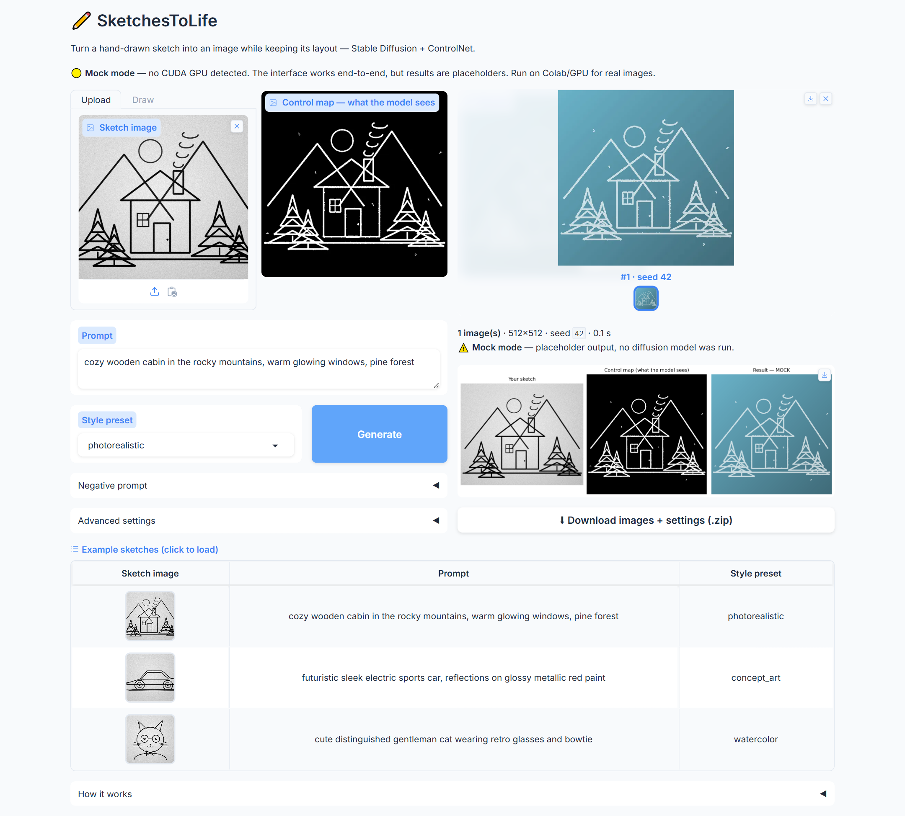
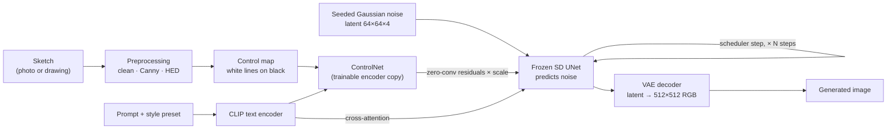
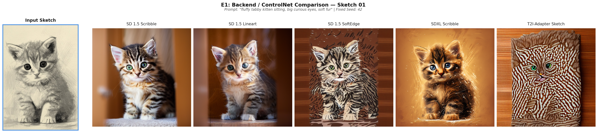
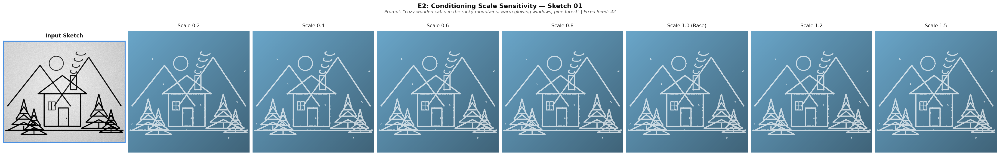
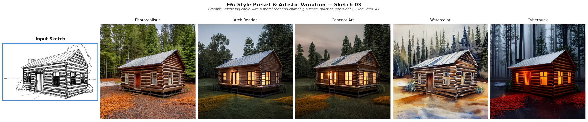

# SketchesToLife

**Turn a rough sketch into a finished image that keeps your layout: Stable Diffusion
guided by ControlNet, run through a reproducible Python pipeline.**

[](https://colab.research.google.com/github/Wajid011/SketchesToLife/blob/main/notebooks/sketch2image_colab.ipynb)


> [!NOTE]
> The figures currently in `results/` were produced on a CPU-only laptop by the pipeline's
> **mock backend** (the control map pasted over a gradient). They show the layout of each
> figure, not model output. Running the [Colab notebook](notebooks/sketch2image_colab.ipynb)
> (or `bash scripts/reproduce.sh` on a GPU) overwrites them with real results at the same paths.

MSc project (3rd semester). Pretrained diffusion models only: no fine-tuning.

---

## Contents

[Features](#features) · [Web app](#web-app) · [Repository structure](#repository-structure) ·
[Installation](#installation) · [Hardware](#hardware-requirements) ·
[Quick start](#quick-start) · [Configuration](#configuration-reference) ·
[How it works](#how-it-works) · [Results](#results) ·
[Reproducibility](#reproducibility) · [References & credits](#references--credits)

## Features

- **Three backends:** SD 1.5 + ControlNet v1.1 (scribble / lineart / softedge),
  SDXL + ControlNet scribble at 1024 px, and SD 1.5 + T2I-Adapter sketch.
- **Robust sketch preprocessing:** illumination normalisation for phone photos,
  adaptive thresholding, automatic inversion, speck removal, stroke thickening/thinning,
  aspect-preserving padding to multiples of 64. Optional Canny / HED / PiDiNet / lineart
  control maps.
- **Style presets:** photorealistic, architectural render, concept art, product studio,
  watercolor, cyberpunk, anime and oil painting, each with matching negative prompts.
- **Eight config-driven experiments (E1–E8)** with publication grids, resumable runs,
  and a JSON sidecar per image recording every parameter, model ID, seed, runtime and peak VRAM.
- **Objective metrics:** edge F1 / IoU with distance tolerance, Chamfer distance and
  edge SSIM for sketch fidelity; CLIPScore for prompt alignment.
- **Gradio web app:** upload or draw, live control-map preview, zip download with settings.
- **Reproducible:** fixed seeds, `scripts/reproduce.sh` with a SHA-256 manifest, and a
  one-click Colab notebook.

## Web app



Upload a sketch or draw one. The control map (exactly what ControlNet receives) appears
beside it. Pick a prompt and preset, tune the advanced settings, and download the results
together with a `settings.json`. *The screenshot comes from a CPU laptop, so the result
panel shows the mock backend, as the in-app banner says.*

## Repository structure

```
SketchesToLife/
├── app/app.py                    Gradio web app
├── configs/
│   ├── default.yaml              all generation settings (see Configuration reference)
│   └── experiments/e1…e8_*.yaml  experiment sweeps (fixed params + swept param)
├── notebooks/
│   └── sketch2image_colab.ipynb  end-to-end Colab run (clone → hero figure → app)
├── scripts/
│   ├── run_experiments.py        run sweeps E1–E8, build grids + hero figure
│   ├── analyze.py                metrics.csv, plots, results/ANALYSIS.md
│   ├── reproduce.sh              regenerate every figure from configs + checksum manifest
│   ├── check_env.py              environment / GPU diagnostic
│   └── create_sample_sketches.py generates the three sample sketches
├── sketches/                     input sketches (sketch_01–03.png)
├── src/sketch2image/
│   ├── preprocessing.py          sketch cleaning + control-map extraction
│   ├── pipelines.py              SketchToImageGenerator (SD 1.5 / SDXL / T2I-Adapter)
│   ├── generate.py               style presets, generation runner, CLI
│   ├── metrics.py                edge F1/IoU, Chamfer, edge SSIM, CLIPScore
│   ├── visualize.py              comparison grids, hero figure
│   └── utils.py                  config loading, seeding, environment info
├── tests/unit/                   CPU-only tests (GPU code is mocked)
├── results/                      figures, metrics, ANALYSIS.md, app screenshots
└── outputs/                      raw generations (git-ignored)
```

## Installation

**pip** (GPU machine / Colab):

```bash
git clone https://github.com/Wajid011/SketchesToLife.git && cd SketchesToLife
# Colab/Kaggle: skip this line, PyTorch is preinstalled. Elsewhere, install a CUDA build
# of PyTorch >= 2.2 matching your Python (2.1.x has no Python 3.12 wheels), e.g.:
pip install torch torchvision --index-url https://download.pytorch.org/whl/cu121
pip install -r requirements.txt
pip install -e . --no-deps
python scripts/check_env.py
```

**conda** (creates the `sketch2image` env with PyTorch + CUDA 12.1 and installs the package):

```bash
conda env create -f environment.yml
conda activate sketch2image
```

**Local CPU development** (tests, linting, UI work in mock mode; downloads no models).
Use a virtual environment with **Python 3.10–3.12**. Python 3.13 cannot install the
pinned numpy 1.26 or torch 2.2.

```powershell
py -3.12 -m venv .venv              # Windows (macOS/Linux: python3.12 -m venv .venv)
.venv\Scripts\activate              # macOS/Linux: source .venv/bin/activate
python -m pip install --upgrade pip
pip install -r requirements-dev.txt
pip install -e . --no-deps
pytest                              # 60 passed, 2 skipped (app + HED tests need GPU-env deps)
```

## Hardware requirements

| Task | Hardware |
|---|---|
| SD 1.5 + ControlNet / T2I-Adapter (512 px) | NVIDIA GPU, fp16. A free Colab **T4 (16 GB)** is enough with attention slicing |
| SDXL + ControlNet (1024 px) | Same T4, with `enable_model_cpu_offload()` (set automatically); several times slower |
| Development, tests, UI | Any CPU machine. Generation falls back to a clearly labelled **mock** backend |
| Disk | Model weights are downloaded to the Hugging Face cache (several GB per backend) |

The JSON sidecar of every generated image records the measured runtime and peak VRAM.

## Quick start

**Single image (CLI):**

```bash
python -m sketch2image.generate --sketch sketches/sketch_01.jpg \
  --prompt "fluffy tabby kitten sitting, big curious eyes, soft fur" \
  --preset photorealistic --scale 1.0 --seed 42
```

Writes the image, a `…_condition.png`, a side-by-side `…_grid.png` and a `…_meta.json`
to `outputs/` (or to `$OUTPUT_DIR`). Add `--mock` to try it on a CPU.

**Batch experiments:**

```bash
python scripts/run_experiments.py -e E1 E2 E6   # or: -e all
python scripts/analyze.py                       # metrics.csv, plots, ANALYSIS.md
```

| ID | Experiment | Swept |
|---|---|---|
| E1 | Backend / ControlNet comparison | SD1.5 scribble · lineart · softedge · SDXL scribble · T2I-Adapter |
| E2 | Conditioning scale | 0.2, 0.4, 0.6, 0.8, 1.0, 1.2, 1.5 |
| E3 | Guidance (CFG) scale | 3, 5, 7.5, 10, 13 |
| E4 | Control guidance end | 0.4, 0.6, 0.8, 1.0 |
| E5 | Preprocessing | raw · cleaned · Canny · lineart |
| E6 | Style presets | photorealistic · architectural render · concept art · watercolor · cyberpunk |
| E7 | Steps × scheduler | {20, 30, 50} × {DPM++ 2M Karras, Euler a, UniPC} |
| E8 | Seed variability | 42, 123, 777, 999 |

**Web app:**

```bash
python app/app.py            # http://127.0.0.1:7860
python app/app.py --share    # public gradio.live link (use this on Colab)
```

Both requirements files pin Gradio 4.31.5 together with the fastapi / starlette /
pydantic / huggingface-hub versions it works with. Newer releases of those break it:
the app then exits with *"When localhost is not accessible, a shareable link must be
created"*. If you see that error, re-run `pip install -r requirements-dev.txt`.

**Colab:** open the badge at the top, choose a T4 runtime, set `REPO_URL`, Run All.

<details>
<summary><b>Deploying the app to Hugging Face Spaces</b> (optional, not deployed)</summary>

1. Create a Space with **SDK: Gradio** on a **GPU** hardware tier (e.g. T4 small).
   Free CPU hardware runs the app in mock mode only.
2. Push this repository and put this header at the top of the Space's `README.md`:
   ```yaml
   ---
   title: SketchesToLife
   sdk: gradio
   sdk_version: 4.31.5
   app_file: app/app.py
   ---
   ```
3. Spaces installs `requirements.txt` and sets `GRADIO_SERVER_NAME`/`GRADIO_SERVER_PORT`,
   which the app reads, so no flags are needed.
</details>

## Configuration reference

Settings come from `configs/default.yaml`, overridden by an experiment YAML or CLI flags.
`OUTPUT_DIR` and `SKETCH_DIR` environment variables override the output/sketch paths.

| Setting (YAML) | CLI flag | Default | Meaning |
|---|---|---|---|
| `backend` | `--backend` | `sd15_controlnet` | `sd15_controlnet` · `sdxl_controlnet` · `t2i_adapter` |
| `controlnet_type` | `--controlnet-type` | `scribble` | SD 1.5 ControlNet: `scribble` · `lineart` · `softedge` |
| `preprocessor` | `--condition-mode` | `hed` | control map: `clean` · `canny` · `hed` · `pidinet` · `lineart` · `none` (neural modes fall back to `clean` without `controlnet-aux`) |
| `prompt` | `--prompt` | — | what the sketch should become |
| — | `--preset` | none | style preset appended to the prompt (+ its negatives) |
| `negative_prompt` | — | built-in list | terms to avoid |
| `controlnet_conditioning_scale` | `--scale` | `1.0` | sketch strength: 0 ignores it, >1.2 very rigid |
| `control_guidance_start` / `_end` | — | `0.0` / `1.0` | fraction of steps during which ControlNet is active |
| `guidance_scale` | `--guidance` | `7.5` | classifier-free guidance (prompt adherence) |
| `num_inference_steps` | `--steps` | `30` | denoising steps |
| `scheduler` | — | DPM++ 2M Karras | also `Euler a`, `UniPC`, `DDIM`, `PNDM` |
| `resolution` | — | `512` (SDXL `1024`) | output side length, padded to a multiple of 64 |
| `seed` | `--seed` | `42` | RNG seed of the initial latent noise |
| `dtype` | — | `float16` | model precision on CUDA |
| `enable_attention_slicing` | — | `true` | lower VRAM at a small speed cost |
| `enable_model_cpu_offload` | — | `false` (SDXL: on) | move idle sub-models to CPU |
| `models.*` | — | see [Reproducibility](#reproducibility) | Hugging Face model IDs |
| `output_dir` | `--out` | `outputs/` | where images + sidecars go |

## How it works



1. **Latent diffusion.** Stable Diffusion denoises in the latent space of a VAE: a 512 px
   image is a 64×64×4 latent. Starting from seeded Gaussian noise, the UNet predicts the
   noise at each step while cross-attending to the CLIP embedding of the prompt. The
   scheduler removes it step by step, and the VAE decoder turns the final latent into pixels.
2. **ControlNet** attaches a *trainable copy* of the UNet's encoder and middle block. It
   reads the control map (plus the prompt) and adds its features back into the frozen
   UNet through **zero convolutions**: 1×1 convolutions initialised to zero. Training
   therefore starts from "no effect" and only learns the structure signal; the base model's
   weights never change.
3. **`conditioning_scale`** multiplies those residuals. Low values make the sketch a loose
   hint, so lines are dropped. High values follow the strokes rigidly and can render them
   as dark seams. **`control_guidance_end`** switches ControlNet off for the last fraction
   of steps, so texture is rendered freely once the layout is fixed.
4. **T2I-Adapter** is a small adapter network that injects sketch features into the UNet
   encoder. It is a much lighter alternative to ControlNet and is generally looser.
   **SDXL** uses a larger UNet with two text encoders and generates natively at 1024 px.

## Results

The experiment grids put the input sketch on the left and the swept setting in the columns
(see the note at the top: the committed images come from the mock backend until a GPU run
replaces them).

| E1 · backends | E2 · conditioning scale |
|---|---|
|  |  |

| E6 · style presets |
|---|
|  |

**Metrics.** `scripts/analyze.py` scores every output and writes `results/metrics.csv`,
the plots (`scale_sweep.png`, `backend_comparison.png`, `tradeoff_scatter.png`) and
`results/ANALYSIS.md`, which explains the best settings, where structure breaks down,
and the failure cases. The table below is filled from `ANALYSIS.md` after the GPU run:

| Backend | Edge F1 (HED, τ=4 px) ↑ | Recall ↑ | Chamfer px ↓ | Edge SSIM ↑ | CLIPScore ↑ | s / image | Peak VRAM |
|---|---|---|---|---|---|---|---|
| SD1.5 scribble | — | — | — | — | — | — | — |
| SD1.5 lineart | — | — | — | — | — | — | — |
| SD1.5 softedge | — | — | — | — | — | — | — |
| SDXL scribble | — | — | — | — | — | — | — |
| T2I-Adapter sketch | — | — | — | — | — | — | — |

*Edge metrics compare edges of the generated image with the cleaned sketch, both thinned
to 1 px at 512×512. Recall is the share of sketch lines that survive. CLIPScore is
100·cos(image, prompt) with `openai/clip-vit-base-patch32`. A LAION aesthetic score is
deliberately not computed; `src/sketch2image/metrics.py` explains why.*

## Reproducibility

**Models** (verified on Hugging Face):

| Role | Model ID | License |
|---|---|---|
| SD 1.5 base | [`stable-diffusion-v1-5/stable-diffusion-v1-5`](https://huggingface.co/stable-diffusion-v1-5/stable-diffusion-v1-5) | CreativeML Open RAIL-M |
| ControlNet scribble (SD 1.5) | [`lllyasviel/control_v11p_sd15_scribble`](https://huggingface.co/lllyasviel/control_v11p_sd15_scribble) | OpenRAIL |
| ControlNet lineart (SD 1.5) | [`lllyasviel/control_v11p_sd15_lineart`](https://huggingface.co/lllyasviel/control_v11p_sd15_lineart) | OpenRAIL |
| ControlNet softedge (SD 1.5) | [`lllyasviel/control_v11p_sd15_softedge`](https://huggingface.co/lllyasviel/control_v11p_sd15_softedge) | OpenRAIL |
| SDXL base | [`stabilityai/stable-diffusion-xl-base-1.0`](https://huggingface.co/stabilityai/stable-diffusion-xl-base-1.0) | CreativeML Open RAIL++-M |
| ControlNet scribble (SDXL) | [`xinsir/controlnet-scribble-sdxl-1.0`](https://huggingface.co/xinsir/controlnet-scribble-sdxl-1.0) | Apache-2.0 |
| SDXL fp16 VAE | [`madebyollin/sdxl-vae-fp16-fix`](https://huggingface.co/madebyollin/sdxl-vae-fp16-fix) | MIT |
| T2I-Adapter sketch | [`TencentARC/t2iadapter_sketch_sd15v2`](https://huggingface.co/TencentARC/t2iadapter_sketch_sd15v2) | Apache-2.0 |
| HED / PiDiNet / lineart annotators | [`lllyasviel/Annotators`](https://huggingface.co/lllyasviel/Annotators) | "other" (see model card) |
| CLIP (CLIPScore metric) | [`openai/clip-vit-base-patch32`](https://huggingface.co/openai/clip-vit-base-patch32) | MIT ([openai/CLIP](https://github.com/openai/CLIP)) |

**Versions** (`requirements.txt`): Python 3.10+, PyTorch 2.1.2 (cu121) in `environment.yml`
(Colab uses its preinstalled build; local CPU dev 2.2.2), diffusers 0.27.2,
transformers 4.40.2, accelerate 0.30.1, huggingface-hub 0.23.0, controlnet-aux 0.0.7,
gradio 4.31.5, numpy 1.26.4, opencv-python 4.9.0.80, scikit-image 0.23.2.
`scripts/check_env.py` prints the versions actually installed.

**Main settings:** seed 42 (E8 adds 123, 777, 999), 30 steps, DPM++ 2M Karras, CFG 7.5,
conditioning scale 1.0, 512 px (SDXL 1024 px), fp16, cleaned-sketch control map.
Every output's `*_meta.json` holds its exact parameters.

**One command:**

```bash
bash scripts/reproduce.sh          # GPU: regenerates every figure in results/
bash scripts/reproduce.sh --mock   # CPU smoke test into outputs/reproduce/results
```

The script starts from an empty scratch folder (runs are resumable and would otherwise
reuse old images). It runs the environment check, preprocessing, E1/E2/E6, the hero figure
and the analysis, then writes `outputs/reproduce/checksums.sha256`. **Verified:** two mock
runs from two clean copies of the repo were byte-identical across all 173 hashed files.
`metrics.csv` and `backend_comparison.png` contain wall-clock runtime and are excluded
from the manifest.

**Determinism caveats:** bit-identical images are expected only on the *same GPU model
with the same torch/CUDA/diffusers versions*. Other GPUs or versions change fp16 kernels,
giving visually near-identical but not bit-identical results. The app, CLI and experiments
all draw the starting noise on the GPU, so the same settings and seed give the same image
in each. SDXL's latent is 128×128 versus SD 1.5's 64×64, so a seed is not comparable
across those backends. Runtime and VRAM always vary.

## References & credits

**Papers**

- R. Rombach, A. Blattmann, D. Lorenz, P. Esser, B. Ommer. *High-Resolution Image Synthesis with Latent Diffusion Models.* CVPR 2022. [arXiv:2112.10752](https://arxiv.org/abs/2112.10752)
- L. Zhang, A. Rao, M. Agrawala. *Adding Conditional Control to Text-to-Image Diffusion Models* (ControlNet). ICCV 2023. [arXiv:2302.05543](https://arxiv.org/abs/2302.05543)
- D. Podell et al. *SDXL: Improving Latent Diffusion Models for High-Resolution Image Synthesis.* 2023. [arXiv:2307.01952](https://arxiv.org/abs/2307.01952)
- C. Mou et al. *T2I-Adapter: Learning Adapters to Dig out More Controllable Ability for Text-to-Image Diffusion Models.* 2023. [arXiv:2302.08453](https://arxiv.org/abs/2302.08453)
- A. Radford et al. *Learning Transferable Visual Models From Natural Language Supervision* (CLIP). ICML 2021. [arXiv:2103.00020](https://arxiv.org/abs/2103.00020)
- S. Xie, Z. Tu. *Holistically-Nested Edge Detection* (HED). ICCV 2015. [arXiv:1504.06375](https://arxiv.org/abs/1504.06375)
- Z. Su et al. *Pixel Difference Networks for Efficient Edge Detection* (PiDiNet). ICCV 2021. [arXiv:2108.07009](https://arxiv.org/abs/2108.07009)
- J. Hessel et al. *CLIPScore: A Reference-free Evaluation Metric for Image Captioning.* EMNLP 2021. [arXiv:2104.08718](https://arxiv.org/abs/2104.08718)

**Libraries**

| Library | Used for | License |
|---|---|---|
| [PyTorch](https://github.com/pytorch/pytorch) | tensor runtime | BSD-3-Clause |
| [🤗 Diffusers](https://github.com/huggingface/diffusers) | SD / SDXL / ControlNet / T2I-Adapter pipelines | Apache-2.0 |
| [🤗 Transformers](https://github.com/huggingface/transformers) | CLIP text encoders, CLIPScore | Apache-2.0 |
| [🤗 Accelerate](https://github.com/huggingface/accelerate) | CPU offload | Apache-2.0 |
| [controlnet_aux](https://github.com/huggingface/controlnet_aux) | HED / PiDiNet / lineart annotators | Apache-2.0 |
| [Gradio](https://github.com/gradio-app/gradio) | web app | Apache-2.0 |
| [OpenCV](https://github.com/opencv/opencv-python) | preprocessing, Canny | Apache-2.0 (OpenCV) / MIT (wheels) |
| [Pillow](https://github.com/python-pillow/Pillow) | image I/O | MIT-CMU |
| [NumPy](https://github.com/numpy/numpy) · [SciPy](https://github.com/scipy/scipy) · [scikit-image](https://github.com/scikit-image/scikit-image) | arrays, distance transforms, skeletons, SSIM | BSD-3-Clause |
| [pandas](https://github.com/pandas-dev/pandas) · [Matplotlib](https://github.com/matplotlib/matplotlib) | analysis tables, figures | BSD-3-Clause · Matplotlib License |
| [PyYAML](https://github.com/yaml/pyyaml) | configs | MIT |
| [pytest](https://github.com/pytest-dev/pytest) · [Ruff](https://github.com/astral-sh/ruff) | tests, lint/format | MIT |
| [Playwright](https://github.com/microsoft/playwright-python) | app screenshots (dev only) | Apache-2.0 |

[OpenCLIP](https://github.com/mlfoundations/open_clip) (MIT) is not a dependency of this
repo. It is credited because SDXL's second text encoder (ViT-bigG/14) was trained with it.
Upstream reference code: [ControlNet v1.1](https://github.com/lllyasviel/ControlNet-v1-1-nightly),
[T2I-Adapter](https://github.com/TencentARC/T2I-Adapter),
[Stability-AI/generative-models](https://github.com/Stability-AI/generative-models),
[CompVis/latent-diffusion](https://github.com/CompVis/latent-diffusion).

**Sketches.** `sketches/` holds the three input images used in every experiment
(`sketch_01`: kitten, `sketch_02`: vintage car, `sketch_03`: log cabin).

**License.** Code: MIT (see [LICENSE](LICENSE)). Generated images are subject to the
licenses of the models above (OpenRAIL family: use-based restrictions apply).
