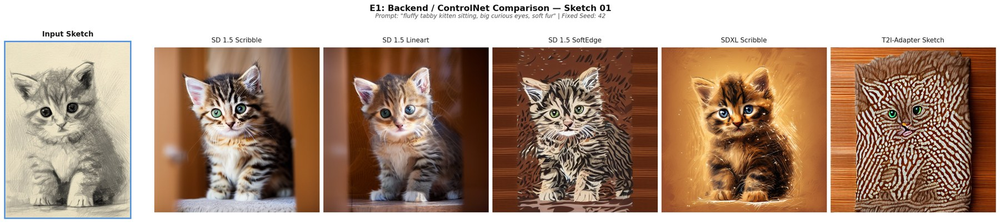
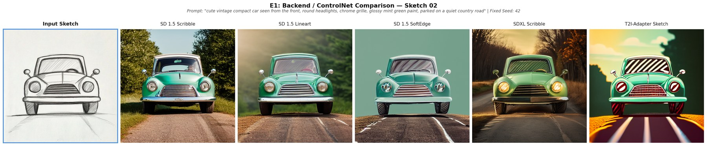
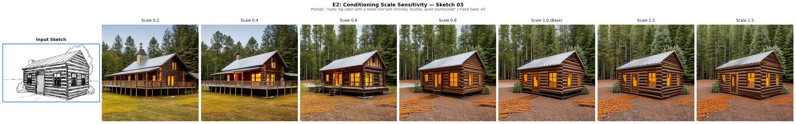
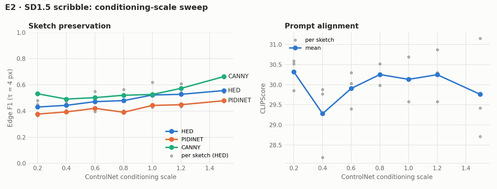
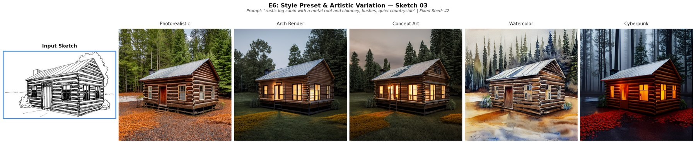
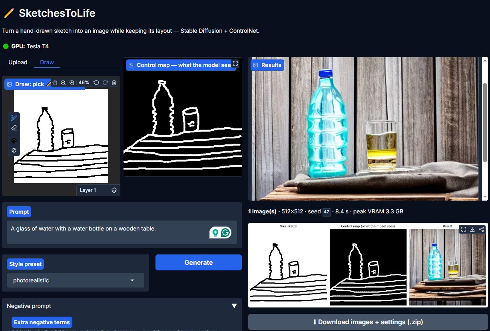
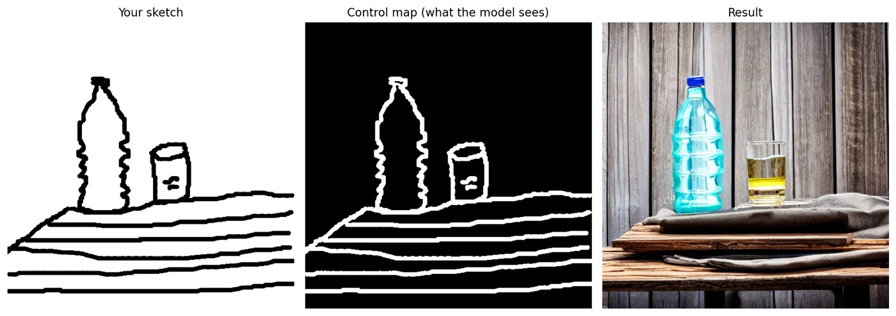
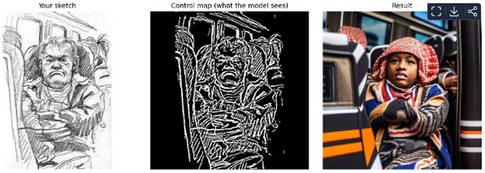

# Bringing Sketches to Life: Structure-Preserving Sketch-to-Image Generation with Pretrained Diffusion Models

**Wajid Ali** · MSc, Machine Learning and Computer Vision II, UPEC · Submitted to: Arezoo Ghodsifard · November 2026 
Code and results: <https://github.com/Wajid011/SketchesToLife>

## 1 Introduction and objective

Hand-drawn sketches fix the layout of a scene (where objects are, their outlines and
proportions) but say little about colour, material or lighting. Text-to-image diffusion
models supply exactly that missing appearance, yet from text alone they choose their own
layout. The objective of this project is a sketch-to-image system that turns a sketch and a
short prompt into a realistic or stylised image **while preserving the sketch's spatial
structure**, using only pretrained models (no fine-tuning). The deliverables are a
config-driven Python pipeline with three conditioning backends, a quantitative evaluation of
structure preservation versus prompt alignment, and a Gradio web interface.

## 2 Background

**Latent diffusion.** Stable Diffusion [1] runs the diffusion process in the latent space of
a variational autoencoder: a 512 × 512 image becomes a 64 × 64 × 4 latent. Starting from
Gaussian noise, a UNet predicts the noise at each step, conditioned on the CLIP [5] text
embedding through cross-attention; a scheduler (here DPM++ 2M Karras) removes it
step by step, and the VAE decoder maps the final latent back to pixels. Classifier-free
guidance (CFG) scales the difference between conditional and unconditional predictions.

**ControlNet.** ControlNet [2] adds spatial conditioning without touching the base model. It
creates a trainable copy of the UNet encoder and middle block that reads a control map (here
the sketch) and feeds its features into the frozen UNet's skip connections through *zero
convolutions*, 1 × 1 convolutions initialised to zero, so training starts from "no effect".
At inference the residuals are multiplied by a **conditioning scale** (0 ignores the sketch,
values above 1 follow it rigidly), and `control_guidance_end` can switch ControlNet off for
the last denoising steps.

**Compared backends.** (i) SD 1.5 with the ControlNet v1.1 *scribble*, *lineart* and *softedge*
models, each trained on a different kind of edge map; (ii) SDXL [3] (larger UNet, two text
encoders, native 1024 px) with the community `xinsir/controlnet-scribble-sdxl-1.0`; and
(iii) the T2I-Adapter sketch model [4], a small (~77 M parameter) network that injects
multi-scale sketch features into the SD 1.5 encoder instead of copying it.

## 3 Method

**3.1 Preprocessing.** Sketches are often phone photos with uneven light. Each input is
EXIF-rotated and converted to greyscale; the background is estimated by morphological closing
and divided out (illumination normalisation); a light blur and adaptive thresholding produce a
binary line map, which is inverted to white-on-black if needed, cleaned of small specks and
optionally thickened or thinned. The map is resized with its aspect ratio preserved and
padded to a multiple of 64. Neural alternatives (HED [6], PiDiNet [7], lineart) and Canny are
available through the same function, but all reported runs use the cleaned map.

**3.2 Generation pipeline.** A single `SketchToImageGenerator` class wraps the three diffusers
pipelines, loads all models in fp16 with attention slicing, enables model CPU offload for SDXL
to fit a 16 GB T4, and tiles the VAE decode. Every run is described by a YAML file
(`configs/`), seeds Python, NumPy and PyTorch, and draws the initial latent from a seeded
CUDA generator. Each image is saved with a JSON sidecar holding all parameters, model IDs,
runtime and peak VRAM; runs are resumable, and `scripts/reproduce.sh` regenerates every
figure from scratch and writes a SHA-256 manifest.

**3.3 Prompt design.** Each sketch has a short content prompt describing only what is drawn
(e.g. *"rustic log cabin with a metal roof and chimney, bushes, quiet countryside"*). Style
presets append a suffix (photorealistic: *"8k UHD, high resolution photograph, sharp focus,
natural daylight, …"*; cyberpunk: *"vivid glowing neon lights, rainy wet asphalt
reflections, …"*) plus preset-specific negatives, on top of a shared negative prompt
(*blurry, low quality, watermark, deformed, …*). CLIPScore is computed against the content
prompt only, so it measures whether the subject is present rather than whether the style
words were obeyed.

**3.4 Web interface.** A Gradio app (Fig. 5, left) accepts an uploaded sketch or a drawing on a
canvas, previews the control map the model will receive, and exposes the prompt, style
preset, backend, ControlNet type, conditioning scale, control end, CFG, steps, seed and line
thickness. Results are shown next to the sketch and control map and can be downloaded as a
zip with a `settings.json`. Only one pipeline is kept in GPU memory, and out-of-memory errors
are reported with concrete remedies.

## 4 Experimental setup

**Sketches.** Three sketches collected from Google Images, chosen for different drawing
styles: a shaded pencil kitten (`sketch_01`), a clean pencil front view of a vintage car
(`sketch_02`) and a dense ink drawing of a log cabin (`sketch_03`). Two further sketches were
tested in the app: a bottle and glass drawn on the app's canvas, and a densely hatched
portrait.

**Hardware.** One NVIDIA Tesla T4 (16 GB) on Kaggle, Python 3.13 with the platform's PyTorch
and Hugging Face libraries.

**Settings.** Unless swept: seed 42, 30 steps, DPM++ 2M Karras, CFG 7.5, conditioning scale
1.0, 512 px (SDXL 1024 px), fp16. **E1** compares the five backends; **E2** sweeps the
conditioning scale over {0.2, 0.4, 0.6, 0.8, 1.0, 1.2, 1.5} for SD 1.5 scribble; **E6**
applies five style presets. Together these give 51 images.

**Metrics.** *Sketch fidelity:* HED edges of the generated image and the cleaned sketch are
thinned to 1 px at 512 × 512; a pixel matches if the other map has an edge within τ = 4 px.
We report edge **F1**, **recall** (share of sketch lines that survive), **precision**, the
symmetric **Chamfer** distance and **edge SSIM**. *Prompt alignment:* **CLIPScore** [8],
100 · cos(image, prompt) with CLIP ViT-B/32. Runtime and peak VRAM are measured per image.

## 5 Results

<figure>

<figcaption>Figure 1. E1: the same sketch, prompt and seed through the five backends.</figcaption>
</figure>

Table 1. E1, mean over the three sketches (best value in bold).

| Backend | F1 ↑ | Recall ↑ | Chamfer px ↓ | Edge SSIM ↑ | CLIP ↑ | s / image | Peak VRAM |
|---|---|---|---|---|---|---|---|
| SD1.5 scribble | 0.523 | 0.432 | 9.9 | 0.520 | **30.1** | 8.4 | 3.4 GB |
| SD1.5 lineart | 0.552 | 0.420 | 6.9 | 0.572 | 29.9 | 8.3 | 3.4 GB |
| SD1.5 softedge | **0.764** | **0.652** | **4.4** | **0.632** | 29.1 | 8.3 | 3.4 GB |
| SDXL scribble | 0.590 | 0.465 | 8.3 | 0.568 | 28.6 | 60.2 | 7.9 GB |
| T2I-Adapter sketch | 0.553 | 0.460 | 10.3 | 0.533 | 28.2 | **6.1** | **2.8 GB** |

<figure>

<figcaption>Figure 2. E2: conditioning scale 0.2 → 1.5 (SD 1.5 scribble, log cabin).</figcaption>
</figure>

Table 2. E2, mean over the three sketches.

| Scale | F1 | Recall | Chamfer s→g | CLIP |
|---|---|---|---|---|
| 0.2 | 0.431 | 0.337 | 10.6 | 30.3 |
| 0.4 | 0.444 | 0.349 | 9.9 | 29.3 |
| 0.6 | 0.472 | 0.375 | 9.3 | 29.9 |
| 0.8 | 0.480 | 0.386 | 9.7 | 30.3 |
| 1.0 | 0.523 | 0.432 | 9.0 | 30.1 |
| 1.2 | 0.528 | 0.432 | 8.7 | 30.2 |
| 1.5 | 0.557 | 0.454 | 7.5 | 29.8 |

<figure>

<figcaption>Figure 3. E2 metrics: edge F1 per edge detector (left) and CLIPScore (right); grey dots are single sketches.</figcaption>
</figure>

<figure>

<figcaption>Figure 4. E6: five style presets at scale 1.0. Mean F1 per preset: photorealistic 0.534, architectural render 0.518, watercolor 0.492, concept art 0.472, cyberpunk 0.422.</figcaption>
</figure>

## 6 Analysis and discussion

**Fidelity versus creativity.** The conditioning scale is the main knob between following
the sketch and letting the model invent. In E2, raising it from 0.2 to 1.5 increases edge F1
from 0.431 to 0.557 (Spearman ρ = +0.48) and reduces the sketch-to-image Chamfer distance
from 10.6 to 7.5 px. Visually (Fig. 2), at 0.2–0.4 the model draws *a* cabin with an added
porch, deck and stone chimney; from 0.8 it draws *this* cabin. Surprisingly, CLIPScore does
not fall at high scale: it stays between 29.3 and 30.3 (ρ = +0.03), so within this range
stronger structure did not cost measurable prompt alignment. Across all 51 images the
correlation between F1 and CLIPScore is only ρ = −0.12, a mild trade-off. Style presets are
where creativity costs fidelity: the cyberpunk preset reaches the highest CLIPScore against
its full styled prompt (33.9) but the lowest F1 (0.422), because its "wet asphalt" and "neon"
cues add structure the sketch does not contain. Its cabin image has the largest
image-to-sketch Chamfer distance of all runs (44.5 px).

**Best settings.** Using the rule "highest CLIPScore among settings within 90 % of the best F1",
SD 1.5 scribble at a scale of 1.0–1.2 is the best general choice (F1 0.523–0.528, CLIP
30.1–30.2): faithful layout, natural textures, 8.4 s per image. Lineart is equivalent on clean
line drawings (car F1 0.640). SDXL gives the most detailed images and the second-best F1
(0.590), but costs 7.2 × the time and 2.4 × the memory of SD 1.5 on a T4. T2I-Adapter is the
cheapest (6.1 s, 2.8 GB).

**Failure cases.** (i) *High edge scores without a good image.* Softedge has the best structure
scores in Table 1, yet on the shaded kitten it renders the pencil hatching as a flat surface
pattern, and T2I-Adapter turns it into zebra stripes (Fig. 1, top; CLIP 26.97 and 25.71).
Because both reproduce strokes literally, the edge metrics reward them. (ii) *Shading lowers
recall.* The shaded kitten keeps only 0.24–0.32 of its sketch lines across E2, against
0.40–0.60 for the ink cabin: soft, overlapping pencil strokes become noisy control maps.
(iii) *Ambiguous lines are reinterpreted.* In the app, the parallel stripes of the drawn table
became folded layers of cloth, and the "glass of water" was filled with a yellow liquid
(Fig. 5, top right). (iv) *Edges carry no identity.* A hatched portrait of an older man became a
child in a knitted hat (Fig. 5, bottom right): the control map fixes outlines, but age and identity
come from the prompt and the model's prior.

<figure>

<figcaption>Figure 5. Left: the web interface in drawing mode. Right, top: the bottle drawing (sketch, control map, result; 8.4 s, 3.3 GB). Right, bottom: a densely hatched portrait of an older man rendered as a child (8.6 s).</figcaption>
</figure>

**Limitations.** Each setting was run with one seed on three sketches, so differences of a
few F1 points may lie within seed noise. Edge metrics reward line-like renderings, and CLIP
measures subject presence rather than realism or style quality; a user study or an aesthetic
predictor would complement them. The backends other than SD 1.5 scribble were evaluated only
at their default settings. Guidance scale, control end, preprocessing, scheduler and seed
sweeps (E3–E5, E7, E8) are configured but were not run within the available GPU time.

## 7 Conclusion and future work

Pretrained ControlNet models turn rough sketches into convincing images on a free T4 GPU in
about eight seconds without any training. SD 1.5 with the scribble ControlNet at a scale of
about 1.0–1.2 offers the best balance between keeping the layout and producing a natural
image. The experiments also show that edge-based fidelity metrics must be read together with
the images. Future work: (i) **LoRA fine-tuning** of the ControlNet or UNet on a small
set of the user's own sketches and target images to learn a personal drawing style and reduce
the misreading of hatching; (ii) a **chatbot or agent integration** in which a language model
turns a conversation into the prompt, picks the backend and scale, and iterates on the
result; (iii) completing the remaining sweeps with several seeds and adding a human
preference study.

## 8 References

[1] R. Rombach, A. Blattmann, D. Lorenz, P. Esser, B. Ommer. High-Resolution Image Synthesis with Latent Diffusion Models. CVPR 2022. arXiv:2112.10752 
[2] L. Zhang, A. Rao, M. Agrawala. Adding Conditional Control to Text-to-Image Diffusion Models. ICCV 2023. arXiv:2302.05543 
[3] D. Podell et al. SDXL: Improving Latent Diffusion Models for High-Resolution Image Synthesis. ICLR 2024. arXiv:2307.01952 
[4] C. Mou et al. T2I-Adapter: Learning Adapters to Dig out More Controllable Ability for Text-to-Image Diffusion Models. AAAI 2024. arXiv:2302.08453 
[5] A. Radford et al. Learning Transferable Visual Models From Natural Language Supervision. ICML 2021. arXiv:2103.00020 
[6] S. Xie, Z. Tu. Holistically-Nested Edge Detection. ICCV 2015. arXiv:1504.06375 
[7] Z. Su et al. Pixel Difference Networks for Efficient Edge Detection. ICCV 2021. arXiv:2108.07009 
[8] J. Hessel et al. CLIPScore: A Reference-free Evaluation Metric for Image Captioning. EMNLP 2021. arXiv:2104.08718 
[9] P. von Platen et al. Diffusers: State-of-the-art diffusion models. GitHub, 2022. https://github.com/huggingface/diffusers 
[10] Models: stable-diffusion-v1-5/stable-diffusion-v1-5; lllyasviel/control_v11p_sd15_{scribble, lineart, softedge}; stabilityai/stable-diffusion-xl-base-1.0; xinsir/controlnet-scribble-sdxl-1.0; madebyollin/sdxl-vae-fp16-fix; TencentARC/t2iadapter_sketch_sd15v2; lllyasviel/Annotators; openai/clip-vit-base-patch32 (all on huggingface.co). 
[11] Input sketches: images found through Google Images, used for non-commercial academic evaluation; copyright remains with their original artists.

