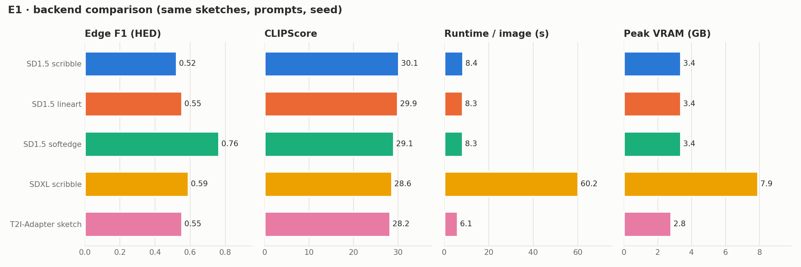
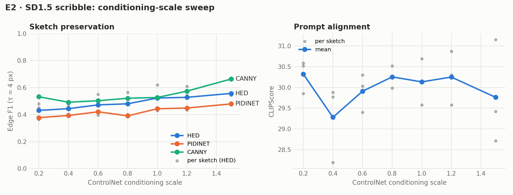
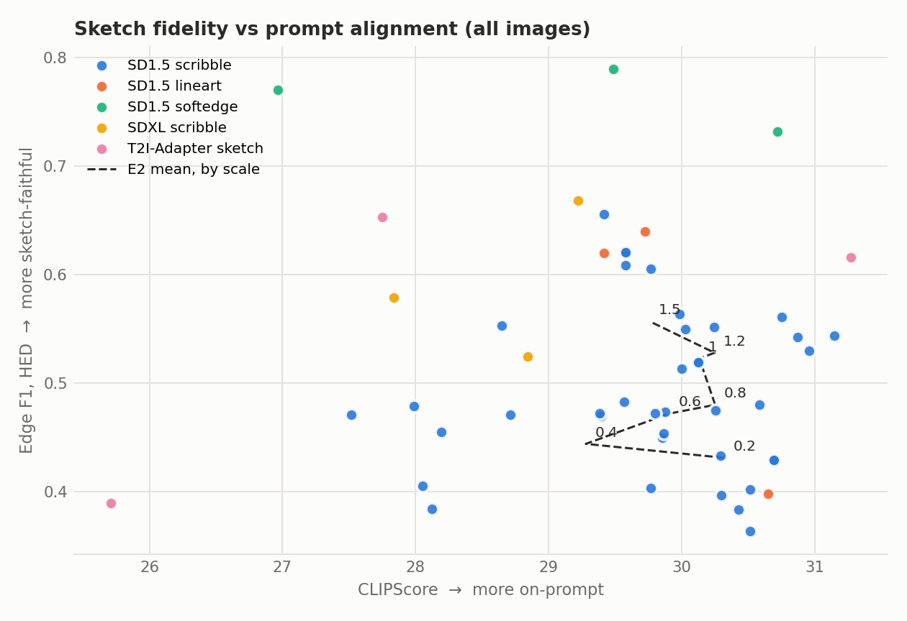

# SketchesToLife — Quantitative Analysis

*Generated by `scripts/analyze.py` from 51 generated images (sketch_01, sketch_02, sketch_03).*

## How to read the metrics

- **Edge F1 / recall / precision** — edges extracted from the generated image (HED, PIDINET, CANNY) vs. the cleaned sketch, both thinned to 1-px lines at 512×512; a pixel matches if the other map has an edge within τ = 4 px. **Recall** = share of sketch lines that survive (the core “was the sketch preserved” number). **Precision** = share of image edges that lie on a sketch line — generated texture (grass, reflections) legitimately lowers it, so precision is *expected* to be well below 1.
- **Chamfer** — mean distance (px) to the nearest matching edge; *sketch→gen* grows when lines are dropped, *gen→sketch* grows when structure is invented.
- **Edge SSIM** — SSIM between the two edge maps after a small blur (shift-tolerant overlap).
- **CLIPScore** — 100·cos(image, prompt) with `openai/clip-vit-base-patch32` against the content prompt (style suffixes excluded; `clip_score_full` in the CSV includes them).
- **Runtime / peak VRAM** — measured per image during generation (`torch.cuda.max_memory_allocated` after a peak reset; includes resident weights).
- **Aesthetic score — deliberately not computed.** The LAION predictor needs another 1.7 GB CLIP-L model plus weights with no verified Hugging Face ID, is trained on photos (unreliable for watercolour/concept-art presets), and quality is not one of our research questions; the side-by-side grids cover it qualitatively.
- Headline structure metric throughout: **HED**.

## Key numbers

### Backends (E1 — same sketches, prompt, seed 42)

| Backend | F1 | Recall | Precision | IoU | Chamfer px | Edge SSIM | CLIP | Runtime s | Peak VRAM MB |
|---|---|---|---|---|---|---|---|---|---|
| SD1.5 scribble | 0.523 | 0.432 | 0.755 | 0.323 | 9.9 | 0.520 | 30.1 | 8.4 | 3434 |
| SD1.5 lineart | 0.552 | 0.420 | 0.879 | 0.358 | 6.9 | 0.572 | 29.9 | 8.3 | 3434 |
| SD1.5 softedge | 0.764 | 0.652 | 0.923 | 0.555 | 4.4 | 0.632 | 29.1 | 8.3 | 3434 |
| SDXL scribble | 0.590 | 0.465 | 0.830 | 0.384 | 8.3 | 0.568 | 28.6 | 60.2 | 8095 |
| T2I-Adapter sketch | 0.553 | 0.460 | 0.768 | 0.370 | 10.3 | 0.533 | 28.2 | 6.1 | 2862 |

### Conditioning scale (E2 — SD1.5 scribble)

| Scale | F1 | Recall | Precision | Chamfer s→g px | Chamfer g→s px | Edge density | CLIP |
|---|---|---|---|---|---|---|---|
| 0.2 | 0.431 | 0.337 | 0.658 | 10.6 | 12.2 | 0.45 | 30.3 |
| 0.4 | 0.444 | 0.349 | 0.665 | 9.9 | 11.8 | 0.45 | 29.3 |
| 0.6 | 0.472 | 0.375 | 0.708 | 9.3 | 11.8 | 0.45 | 29.9 |
| 0.8 | 0.480 | 0.386 | 0.718 | 9.7 | 12.1 | 0.45 | 30.3 |
| 1 | 0.523 | 0.432 | 0.755 | 9.0 | 10.9 | 0.48 | 30.1 |
| 1.2 | 0.528 | 0.432 | 0.765 | 8.7 | 12.0 | 0.48 | 30.2 |
| 1.5 | 0.557 | 0.454 | 0.772 | 7.5 | 7.7 | 0.49 | 29.8 |

*Edge density = generated edge pixels ÷ sketch edge pixels. An image that simply redraws the strokes already scores ≈2 (Canny finds both borders of a stroke), so compare density across scales rather than against 1.*

## Best settings per backend

Rule: among the settings that keep edge F1 within 90 % of that backend's best, pick the most on-prompt one (highest CLIP).

| Backend | Configs tried | Recommended | F1 | CLIP |
|---|---|---|---|---|
| SD1.5 scribble | 12 | preset=none, conditioning_scale=1.2 | 0.528 | 30.2 |
| SD1.5 lineart | 1 | default (only setting tested) | 0.552 | 29.9 |
| SD1.5 softedge | 1 | default (only setting tested) | 0.764 | 29.1 |
| SDXL scribble | 1 | default (only setting tested) | 0.590 | 28.6 |
| T2I-Adapter sketch | 1 | default (only setting tested) | 0.553 | 28.2 |

Backends with a single configuration were only run at their defaults in E1, so their “best” is not tuned — a fair caveat when comparing them with SD1.5 scribble, which was swept.

## Where structure breaks down

- Sketch-line recall goes from **0.34** at scale 0.2 to **0.45** at 1.5 (Spearman ρ scale↔F1 = +0.48).
- Recall first reaches 90 % of its maximum at **scale 1**; below that, the sketch is treated as a suggestion and lines are dropped (Chamfer sketch→gen 10.6 px at 0.2 vs 7.5 px at 1.5).
- Edge F1 peaks at **scale 1.5**.
- CLIP peaks at **scale 0.2** (30.3) and is 29.8 at 1.5 (ρ scale↔CLIP = +0.03). CLIP stays within 1.0 points across the sweep, so prompt alignment shows no consistent trend with scale.

Per-sketch recall by scale (which drawings lose their lines first):

| sketch | 0.2 | 0.4 | 0.6 | 0.8 | 1 | 1.2 | 1.5 |
|---|---|---|---|---|---|---|---|
| sketch_01 | 0.235 | 0.264 | 0.255 | 0.257 | 0.277 | 0.279 | 0.319 |
| sketch_02 | 0.352 | 0.380 | 0.389 | 0.394 | 0.422 | 0.452 | 0.451 |
| sketch_03 | 0.424 | 0.402 | 0.482 | 0.506 | 0.597 | 0.564 | 0.594 |

Across all 51 images the fidelity/alignment correlation is ρ = -0.12 (weakly negative: a mild trade-off).

## Failure cases (auto-selected — open the images to confirm)

### Ignored lines (lowest sketch recall)

| experiment | sketch | backend_label | preset | conditioning_scale | hed_recall | hed_precision | hed_chamfer_s2g | hed_chamfer_g2s | clip_score | image |
|---|---|---|---|---|---|---|---|---|---|---|
| E2 | sketch_01 | SD1.5 scribble | none | 0.2 | 0.235 | 0.798 | 14.8 | 5.3 | 30.5 | `sketch_01_sd15_controlnet_scribble_scale0.2_seed42_0.png` |
| E6 | sketch_01 | SD1.5 scribble | concept_art | 1 | 0.238 | 0.972 | 17.4 | 1.5 | 30.4 | `sketch_01_concept_art_sd15_controlnet_scribble_seed42_0.png` |
| E1 | sketch_01 | SD1.5 lineart | none | 1 | 0.252 | 0.950 | 14.0 | 1.6 | 30.7 | `sketch_01_sd15_controlnet_lineart_seed42_0.png` |

**Why:** ControlNet's output enters the frozen UNet as residuals added after zero convolutions, multiplied by `conditioning_scale`. When that residual is small relative to the text cross-attention signal, the UNet follows its prior for the prompt (“a cabin”) and only loosely respects where the lines are; thin or isolated strokes (chimney smoke, whiskers) carry the least signal through the 8×-downsampled latent and vanish first.

### Invented structure (highest gen→sketch Chamfer)

| experiment | sketch | backend_label | preset | conditioning_scale | hed_recall | hed_precision | hed_chamfer_s2g | hed_chamfer_g2s | clip_score | image |
|---|---|---|---|---|---|---|---|---|---|---|
| E6 | sketch_03 | SD1.5 scribble | cyberpunk | 1 | 0.405 | 0.364 | 10.5 | 44.5 | 28.1 | `sketch_03_cyberpunk_sd15_controlnet_scribble_seed42_0.png` |
| E6 | sketch_03 | SD1.5 scribble | watercolor | 1 | 0.525 | 0.400 | 6.6 | 36.3 | 29.9 | `sketch_03_watercolor_sd15_controlnet_scribble_seed42_0.png` |
| E2 | sketch_03 | SD1.5 scribble | none | 0.2 | 0.424 | 0.554 | 6.9 | 20.9 | 30.6 | `sketch_03_sd15_controlnet_scribble_scale0.2_seed42_0.png` |

**Why:** large blank areas of the sketch give ControlNet no constraint, so the base model fills them with prompt-driven detail (forests, sky texture, reflections). This is often desirable — it is where realism comes from — but it lowers precision.

### Over-constrained (scale ≥ 1.2 and below the sketch's median CLIP)

| experiment | sketch | backend_label | preset | conditioning_scale | hed_recall | hed_precision | hed_chamfer_s2g | hed_chamfer_g2s | clip_score | image |
|---|---|---|---|---|---|---|---|---|---|---|
| E2 | sketch_01 | SD1.5 scribble | none | 1.5 | 0.319 | 0.899 | 10.2 | 2.1 | 28.7 | `sketch_01_sd15_controlnet_scribble_scale1.5_seed42_0.png` |
| E2 | sketch_03 | SD1.5 scribble | none | 1.5 | 0.594 | 0.733 | 5.8 | 13.3 | 29.4 | `sketch_03_sd15_controlnet_scribble_scale1.5_seed42_0.png` |
| E2 | sketch_03 | SD1.5 scribble | none | 1.2 | 0.564 | 0.660 | 6.0 | 19.1 | 29.6 | `sketch_03_sd15_controlnet_scribble_scale1.2_seed42_0.png` |

**Why:** at high scale the residuals dominate at *every* denoising step, including the late steps that normally render texture. The model then reproduces the strokes themselves — dark seams, outlined panels, flat cartoon shading — instead of treating them as boundaries, and semantic content from the prompt loses out. Lowering `control_guidance_end` releases the late steps and is the usual fix (not swept in this run).

### Text and hands

Not measured: none of the three benchmark prompts contain legible text or hands, so this failure mode is not exercised by the data. The expected behaviour, for the report: a scribble map gives only *where* edges are, not *what* they are, so a five-finger outline has no constraint on joint topology and SD 1.5 (64×64 latent) cannot resolve small glyphs; ControlNet can fix a hand's silhouette but not its anatomy. Adding a hand / sign sketch would be needed to test this.

## Metric limitations

- Edge metrics on generated images reward line-like renderings: a flat cartoon can outscore a photo with equally correct structure, so read F1 together with CLIP and the grids.
- One seed per setting; differences of a few F1 points may be within seed noise.
- CLIP measures subject presence, not style quality or realism.
